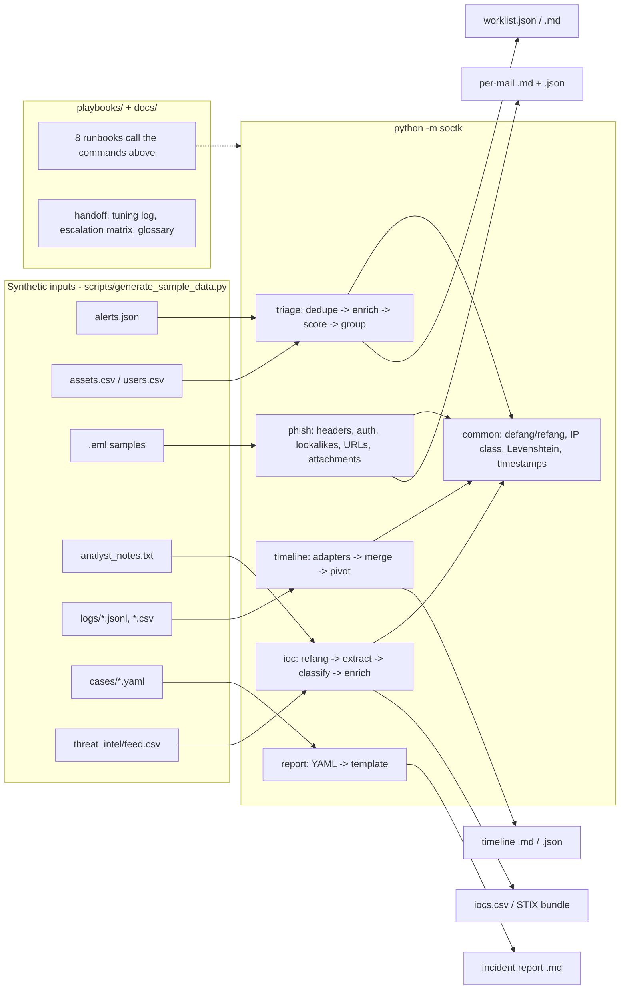

# SOC Analyst Toolkit (`soctk`)

The tools and playbooks a Tier 1 / Tier 2 SOC analyst actually uses on shift: alert triage, phishing e-mail analysis, IOC extraction, incident timelines and report generation, plus the runbooks and templates that go with them.

   

## Why this project exists

A SOC analyst's day is a queue of alerts that must be de-duplicated, enriched, prioritised and grouped before anyone can investigate; a reported e-mail that needs its headers, links and attachments pulled apart in minutes; indicators that have to be extracted, defanged and shared safely; and, at the end, a timeline and a report that someone outside the SOC can read. Most of that work happens in whatever tools the shop has, but the underlying logic - DMARC alignment, lookalike domains, priority scoring, entity grouping - is the same everywhere. This repo implements that logic from scratch in Python, against synthetic data, with the playbooks that tell an analyst *when* to run each tool and *what to do* with the result.

## What it demonstrates

- Alert triage pipeline: de-duplication, asset/user enrichment, `severity x criticality x confidence` scoring, union-find grouping of alerts into incidents by shared host / user / external IP in a time window
- Phishing analysis with only the standard library `email` package: Received-chain hop walk, `Authentication-Results` parsing (SPF/DKIM/DMARC and alignment), From / Return-Path / Reply-To mismatch, display-name and VIP impersonation, lookalike domains (Levenshtein, transposition, homoglyph normalisation, hyphen padding, embedded sub-labels), link-text/href mismatch, attachment hashing and macro / double-extension / PE-magic detection
- IOC extraction with correct defang/refang round-tripping (`hxxp`, `[.]`, `(.)`, `{.}`, `[dot]`, `[:]`, `[@]`), hash-length precedence, filename/timestamp/MAC false-positive avoidance, private/reserved IP classification, offline threat-intel enrichment and CSV / STIX-2.1-style export
- Multi-source log normalisation (auth, process, network, EDR; JSON, JSON-lines, CSV) into one sorted timeline with entity pivoting
- Template-driven incident reporting from a YAML case file with NIST SP 800-61 phases, dwell-time / time-to-contain metrics, defanged IOC tables and ATT&CK mapping
- Eight runbooks written to be executed under pressure, a shift-handoff template, an alert-tuning log with a review discipline, an escalation matrix and a glossary
- 80 pytest tests covering regexes, parsers, scoring, grouping, ordering and the CLI end-to-end

### Mapping to Security+ (SY0-701), MITRE ATT&CK and NIST CSF

| Feature | Security+ domain / objective | ATT&CK | NIST CSF |
| --- | --- | --- | --- |
| `triage` priority scoring, incident grouping, worklist | 4.4 Security alerting and monitoring; 4.8 Incident response (preparation, detection, analysis) | technique IDs carried per alert (T1110, T1059.001, T1003.001, T1486 ...) | Detect (DE.AE), Respond (RS.AN) |
| `phish` header / auth / lookalike / attachment analysis | 2.2 Social engineering (phishing, BEC, pretexting, typosquatting); 1.4 Cryptographic solutions (DKIM signatures); 3.2 E-mail security (SPF/DKIM/DMARC) | T1566.001/.002 Phishing, T1204.002 User Execution, T1036 Masquerading, T1598 | Detect (DE.CM), Protect (PR.AT) |
| `ioc` extraction, defang/refang, enrichment, STIX export | 4.8 Incident response (threat hunting, IOCs); 2.4 Indicators of malicious activity; 4.9 Data sources for investigation | T1071 (C2), T1105 Ingress Tool Transfer, T1003 Credential Dumping (hash IOCs) | Detect (DE.AE), Respond (RS.AN), Identify (ID.RA) |
| `timeline` multi-source merge and pivot | 4.9 Investigation data sources (logs, endpoint, network); 4.8 Analysis | T1059.001 PowerShell, T1218.011 Rundll32, T1053.005 Scheduled Task, T1071.001 Web C2 | Respond (RS.AN) |
| `report` incident report with NIST 800-61 phases | 4.8 Incident response process (containment, eradication, recovery, lessons learned); 5.1 Reporting | tactic + technique table in every report | Respond (RS.CO, RS.MI), Recover (RC.IM) |
| Playbooks: brute force, impossible travel | 2.4 Password attacks (spraying, brute force), account compromise indicators; 4.6 IAM | T1110.001/.003/.004, T1078, T1550.004 | Detect, Respond |
| Playbooks: malware, PowerShell, ransomware | 2.4 Malware / ransomware indicators, living-off-the-land | T1204, T1059.001, T1562.001, T1490, T1486 | Respond, Recover (RC.RP) |
| Playbooks: exfiltration, insider | 2.1 Threat actors (insider); 5.1 Data classification; 5.3 Evidence / chain of custody | T1567, T1048, T1052.001, T1530 | Respond, Govern (GV.PO) |
| Docs: handoff, tuning log, escalation matrix | 4.8 Preparation; 5.2 Risk / SLAs; 5.6 Awareness | - | Govern, Respond (RS.MA) |

## Architecture



## Quickstart

```bash
git clone https://github.com/brooklynkid707-cmd/soc-analyst-toolkit.git
cd soc-analyst-toolkit
pip install --break-system-packages -r requirements.txt   # pyyaml + pytest
python -m pytest -q                                        # 80 passed

python scripts/generate_sample_data.py                     # regenerate synthetic data (already committed under data/)
make demo                                                  # runs every subcommand below
```

Individual commands:

```bash
python -m soctk triage data/alerts.json --top 5
python -m soctk phish data/samples/eml --out-dir output/phish
python -m soctk ioc data/samples/analyst_notes.txt --csv output/iocs.csv --stix output/iocs_stix.json
python -m soctk timeline data/logs --pivot WS-FIN-017 --out output/timeline_ws-fin-017.md
python -m soctk report data/cases/INC-2026-0142.yaml --out output/INC-2026-0142.md
```

Every subcommand has `--help`. `ioc` reads stdin with `-` so you can pipe a ticket or chat paste straight in.

## Sample output

All output below is captured verbatim from `make demo` on the committed synthetic data.

### `triage` - 60 raw alerts become 31 incidents, the real attack chains rise to the top

```
$ python -m soctk triage data/alerts.json --top 5
Ingested 60 alerts -> 53 after de-dup -> 31 incidents

Incident      Pri  Score  Alerts  Window (UTC)  ATT&CK                  Entities
--------------------------------------------------------------------------------------------------------------
INC-2026-0001 P1   100    6       08:14-09:09    T1003.001, T1059.001,   host:ws-fin-017, ip:203.0.113.45, ip:203.0.113.77, user:mriv
    P4    19  08:14:00  medium   Phishing e-mail reported by user
    P2    71  08:23:00  critical Office spawned shell process
    P3    47  08:24:00  high     Suspicious PowerShell: encoded command
    P2    77  08:26:00  critical Outbound connection to known C2 indicator (+2 dup)
    P1    88  08:55:00  critical EDR: credential dumping tool detected
    P3    41  09:09:00  high     Local admin group modified
INC-2026-0002 P1   100    6       10:30-11:05    T1078.002, T1486, T149  host:srv-file-02, ip:198.51.100.90, user:admin.rfoster, user
    P4    24  10:30:00  medium   Service account interactive logon
    P2    57  10:36:00  high     Antivirus signature disabled
    P1   100  10:38:00  critical Volume shadow copy deletion
    P1    80  10:39:00  critical Mass file rename with unusual extension
    P4    22  11:00:00  medium   Phishing e-mail reported by user
    P4    19  11:05:00  medium   Phishing e-mail reported by user
INC-2026-0003 P2   71     3       07:03-08:01    T1078, T1110, T1110.00  host:srv-dc-01, ip:198.51.100.23, user:tgarcia
    P2    65  07:03:00  high     Brute force: 20+ failed logons from single source (+5 dup)
    P2    58  07:28:00  high     Password spray: 1 failure per account across 50 accounts
    P4    25  08:01:00  high     Impossible travel: logon from two countries in 1h
INC-2026-0004 P3   38     3       09:25-10:10    T1071.004, T1566.002,   host:lt-exec-001, host:ws-fin-022, ip:192.0.2.15, ip:192.0.2
    P3    32  09:25:00  medium   Large outbound transfer to cloud storage
    P4    16  09:58:00  medium   Phishing e-mail reported by user
    P4    14  10:10:00  low      DNS query to newly registered domain
INC-2026-0005 P3   36     3       08:15-09:02    T1046, T1053.005        host:srv-bkp-06, host:srv-db-04, user:helpdesk1, user:svc_ba
    P4    20  08:15:00  medium   New scheduled task created
    P3    31  08:45:00  medium   Port scan from internal host
    P3    34  09:02:00  medium   Port scan from internal host
... 26 lower-priority incidents omitted (use --top)

Written: output/worklist.json
Written: output/worklist.md
```

### `phish` - six sample e-mails, two benign and four malicious

```
$ python -m soctk phish data/samples/eml --out-dir output/phish
=== 01_benign_expense_approval.eml ===
  Verdict : LIKELY BENIGN  (score 3/100)
  Subject : Your expense report ER-2291 was approved
  From    : Expense System <notifications@corp[.]example[.]com>
  Auth    : SPF=pass DKIM=pass DMARC=pass
  Hops    : 2  origin=10[.]10[.]1[.]22
  [ 3] low      header     Originating hop IP 10.10.1.22 is private (internal submission or stripped headers)
  URLs    : hxxps://expenses[.]corp[.]example[.]com/reports/2291
  Report  : output/phish/01_benign_expense_approval.md

=== 02_credential_phish_bank.eml ===
  Verdict : MALICIOUS  (score 100/100)
  Subject : Action Required: Unusual sign-in detected - verify your account within 24 hours
  From    : Example Bank Security <alerts@example-bank[.]com>
  Auth    : SPF=softfail DKIM=none DMARC=fail
  Hops    : 2  origin=192[.]168[.]1[.]44
  [25] critical lookalike  Reply-To domain cdn-assets-example[.]com impersonates example.com (hyphen padding around protected name)
  [25] critical lookalike  Return-Path domain mailer[.]cdn-assets-example[.]com impersonates example.com (hyphen padding around protected name)
  [20] high     auth       DMARC fail
  [20] critical lookalike  URL host secure-login-example[.]com impersonates example.com (hyphen padding around protected name)
  [15] high     auth       SPF softfail
  [15] high     body       Link text 'https://www.example-bank.com/verify' points to hxxp://203[.]0[.]113[.]77/login/verify[.]php?id=1182
  [12] medium   body       Urgency/pressure language: immediately, within 24 hours, suspended, verify your, confirm your
  [10] medium   sender     Return-Path domain mailer.cdn-assets-example.com != From domain example-bank.com
  [10] medium   sender     Reply-To verify@cdn-assets-example[.]com differs from From alerts@example-bank[.]com
  [ 8] medium   header     No external hop belongs to sender domain example-bank.com (sent via unrelated infrastructure)
  [ 8] medium   body       URL uses a bare IP address: hxxp://203[.]0[.]113[.]77/login/verify[.]php?id=1182
  ...

=== 03_bec_ceo_fraud.eml ===
  Verdict : MALICIOUS  (score 60/100)
  Subject : Quick favor - are you available?
  From    : "Victoria Harlan (CEO)" <victoria[.]harlan[.]ceo@gmail[.]com>
  Auth    : SPF=pass DKIM=pass DMARC=pass
  Hops    : 1  origin=198[.]51[.]100[.]41
  [20] critical sender     Display name matches VIP 'Victoria Harlan' but sender domain gmail[.]com is external
  [15] high     sender     Display name 'Victoria Harlan (CEO)' claims an internal role but address is victoria[.]harlan[.]ceo@gmail[.]com
  [12] medium   body       Urgency/pressure language: urgent, wire, confidential, do not share, are you available
  [ 8] medium   header     No external hop belongs to sender domain gmail.com (sent via unrelated infrastructure)
  [ 5] low      sender     Sender uses free webmail domain gmail.com

=== 04_malware_invoice_attachment.eml ===
  Verdict : MALICIOUS  (score 100/100)
  Subject : Invoice Q3-8812 overdue - immediate payment required
  From    : Accounts Payable - Example Corp <invoice-team@cdn-assets-example[.]com>
  Auth    : SPF=fail DKIM=fail DMARC=none
  Hops    : 2  origin=203[.]0[.]113[.]45
  [25] critical lookalike  From domain cdn-assets-example[.]com impersonates example.com (hyphen padding around protected name)
  [25] critical lookalike  Return-Path domain cdn-assets-example[.]com impersonates example.com (hyphen padding around protected name)
  [25] critical attachment Invoice_Q3_8812.docm: contains vbaProject.bin (VBA macro)
  [25] critical attachment Invoice_Q3_8812.pdf.exe: dangerous extension .exe
  [25] critical attachment Invoice_Q3_8812.pdf.exe: double extension .pdf.exe
  [25] critical attachment Invoice_Q3_8812.pdf.exe: PE executable magic bytes (MZ)
  [15] high     auth       SPF fail
  [12] high     auth       DKIM fail
  [12] high     attachment Invoice_Q3_8812.docm: macro-capable Office format .docm
  [ 4] low      auth       DMARC none (no policy / not evaluated)
  Attach  : Invoice_Q3_8812.docm (421 B) sha256=9b2c6a576c6aa5c0... macro-capable Office format .docm; contains vbaProject.bin (VBA macro)
  Attach  : Invoice_Q3_8812.pdf.exe (260 B) sha256=66c41c696df1aabd... dangerous extension .exe; double extension .pdf.exe; PE executable magic bytes (MZ)

=== 05_lookalike_m365_password.eml ===
  Verdict : MALICIOUS  (score 97/100)
  Subject : Your password expires today - keep your current password
  From    : Microsoft 365 Support <support@micros0ft-support[.]com>
  Auth    : SPF=pass DKIM=pass DMARC=pass
  Hops    : 2  origin=127[.]0[.]0[.]1
  [25] critical lookalike  From domain micros0ft-support[.]com impersonates microsoft.com (homoglyph substitution ('micros0ft' ~ 'microsoft'))
  [25] critical lookalike  Return-Path domain micros0ft-support[.]com impersonates microsoft.com (homoglyph substitution ('micros0ft' ~ 'microsoft'))
  [20] critical lookalike  URL host login[.]rnicrosoft-online[.]example[.]net impersonates microsoft.com (homoglyph substitution ('rnicrosoft' ~ 'microsoft'))
  [ 8] medium   header     No external hop belongs to sender domain micros0ft-support.com (sent via unrelated infrastructure)
  [ 6] medium   body       Credential-themed URL path: hxxps://login[.]rnicrosoft-online[.]example[.]net/common/oauth2/reset
  [ 6] medium   body       Credential keywords with links present: password
  [ 4] low      body       Urgency/pressure language: password expire

Summary:
    3  LIKELY BENIGN  01_benign_expense_approval.eml
  100  MALICIOUS      02_credential_phish_bank.eml
   60  MALICIOUS      03_bec_ceo_fraud.eml
  100  MALICIOUS      04_malware_invoice_attachment.eml
   97  MALICIOUS      05_lookalike_m365_password.eml
    3  LIKELY BENIGN  06_benign_internal_helpdesk.eml
```

Note sample 05: SPF, DKIM and DMARC all *pass* - the attacker owns the lookalike domain, so authentication tells you nothing. Only the lookalike check catches it.

### `ioc` - defanged analyst notes in, enriched indicator table out

```
$ python -m soctk ioc data/samples/analyst_notes.txt --csv output/iocs.csv --stix output/iocs_stix.json
Extracted 17 unique indicators from data/samples/analyst_notes.txt
  url=2, email=1, ipv4=5, ipv6=2, domain=2, sha256=2, sha1=1, md5=1, cve=1
  Threat-intel matches: 9

| Type | Indicator (defanged) | Class | Seen | TI verdict | TI tags |
| --- | --- | --- | --- | --- | --- |
| url | hxxp://update-service[.]example[.]net/gate[.]php | - | 1 | malicious | c2-checkin |
| url | hxxps://cdn-assets-example[.]com/assets/upd[.]bin | - | 1 | malicious | phishing,credential-harvest |
| email | invoice-team@cdn-assets-example[.]com | - | 1 | malicious | phishing-sender |
| ipv4 | 10[.]10[.]1[.]10 | private | 1 | - | - |
| ipv4 | 10[.]10[.]20[.]10 | private | 1 | - | - |
| ipv4 | 127[.]0[.]0[.]1 | loopback | 1 | - | - |
| ipv4 | 198[.]51[.]100[.]23 | documentation | 1 | malicious | brute-force,scanner |
| ipv4 | 203[.]0[.]113[.]45 | documentation | 1 | malicious | c2,cobalt-strike |
| ipv6 | 2001:db8:85a3::8a2e:370:7334 | documentation | 1 | - | - |
| ipv6 | fe80::1 | link-local | 1 | - | - |
| domain | secure-login-example[.]com | tld:com | 1 | malicious | phishing |
| domain | www[.]example[.]com | tld:com | 1 | - | - |
| sha256 | 4b1d0e8c6f2a9b3c7d5e1f0a8b6c4d2e9f7a5b3c1d0e8f6a4b2c0d8e6f4a2b1c | - | 1 | - | - |
| sha256 | 9f2c1e8ab7d64c3f0a5e2b19d8c7f6a4e3b2c1d0f9e8d7c6b5a4f3e2d1c0b9a8 | - | 1 | - | - |
| sha1 | 3395856ce81f2b7382dee72602f798b642f14140 | - | 1 | malicious | test-file |
| md5 | 44d88612fea8a8f36de82e1278abb02f | - | 1 | malicious | test-file |
| cve | CVE-2024-21413 | - | 1 | exploited | outlook,monikerlink |

CSV written: output/iocs.csv
STIX bundle written: output/iocs_stix.json
```

The notes file deliberately contains `svchost.exe`, `report.pdf`, clock times (`08:24:05`) and a MAC address; none of them are extracted.

### `timeline` - five log files, one host pivot

```
$ python -m soctk timeline data/logs --pivot WS-FIN-017 --out output/timeline_ws-fin-017.md
Merged 49 events from 5 source files; pivot on 'WS-FIN-017' -> 14 events

Time (UTC)           Src      Sev      Action            Host            User           Detail
------------------------------------------------------------------------------------------------------------------------
2026-10-14T08:05:00Z auth     info     logon_success     WS-FIN-017      mrivera        Interactive event_id=4624
2026-10-14T08:23:00Z process  info     process_create    WS-FIN-017      mrivera        explorer.exe -> OUTLOOK.EXE :: OUTLOOK.EXE
2026-10-14T08:23:40Z process  info     process_create    WS-FIN-017      mrivera        OUTLOOK.EXE -> WINWORD.EXE :: WINWORD.EXE /n "C:\Users\mrive
2026-10-14T08:23:50Z network  info     conn_allow        WS-FIN-017      -              tcp/443 bytes_out=1200 cdn-assets-example.com
2026-10-14T08:24:02Z process  high     process_create    WS-FIN-017      mrivera        WINWORD.EXE -> cmd.exe :: cmd.exe /c powershell -nop -w hidd
2026-10-14T08:24:03Z process  high     process_create    WS-FIN-017      mrivera        cmd.exe -> powershell.exe :: powershell -nop -w hidden -enc 
2026-10-14T08:24:05Z edr      high     detection         WS-FIN-017      mrivera        Suspicious Office child process C:\Users\mrivera\Downloads\I
2026-10-14T08:26:00Z process  high     process_create    WS-FIN-017      mrivera        powershell.exe -> rundll32.exe :: rundll32.exe C:\Users\Publ
2026-10-14T08:26:05Z network  info     conn_allow        WS-FIN-017      -              tcp/443 bytes_out=2210 update-service.example.net
2026-10-14T08:41:00Z edr      critical detection         WS-FIN-017      mrivera        Credential dumping - LSASS handle from rundll32.exe C:\Users
2026-10-14T08:41:03Z network  info     conn_allow        WS-FIN-017      -              tcp/443 bytes_out=1785 update-service.example.net
2026-10-14T08:55:00Z process  medium   process_create    WS-FIN-017      mrivera        rundll32.exe -> schtasks.exe :: schtasks /create /tn OneDriv
2026-10-14T08:56:05Z network  info     conn_allow        WS-FIN-017      -              tcp/443 bytes_out=1781 update-service.example.net
2026-10-14T08:58:00Z edr      info     quarantine        WS-FIN-017      mrivera        Host network-isolated by analyst

Markdown written: output/timeline_ws-fin-017.md
```

### `report` - YAML case file to a 138-line incident report

```
$ python -m soctk report data/cases/INC-2026-0142.yaml --out output/INC-2026-0142.md
Report written: output/INC-2026-0142.md (138 lines)

# Incident Report INC-2026-0142: Macro phishing leading to credential dumping on WS-FIN-017

| | |
| --- | --- |
| **Classification** | TLP:AMBER |
| **Severity** | HIGH |
| **Status** | Closed - eradicated |
| **Incident type** | Phishing -> malware execution -> credential access |
| **Lead analyst** | J. Scirica (Tier 2) |
| **Detection source** | EDR (Suspicious Office child process) + user phishing report |
| **Report generated** | 2026-10-18T04:12:12Z |

## 1. Executive summary

On 2026-10-14 a finance analyst (mrivera) opened a macro-enabled invoice attached to
a phishing e-mail impersonating a vendor. The macro launched an encoded PowerShell
loader that retrieved a DLL from update-service.example.net and established a 15-minute
HTTPS beacon to 203.0.113.45. EDR observed the DLL opening a handle to LSASS and the host
was network-isolated 44 minutes after initial execution. No lateral movement or data
exfiltration was identified. The user's credentials were reset and the host reimaged.
...
```

The generated report continues with key times and metrics (dwell time 0h 10m, time to contain 0h 33m), affected assets, the sorted timeline, a defanged IOC table, the ATT&CK table (tactic ID resolved to its name), the four NIST 800-61 response sections, evidence, lessons learned and recommendations.

### Tests

```
$ python -m pytest -q
................................................................................ [100%]
80 passed in 0.90s
```

## Project layout

```
soc-analyst-toolkit/
├── soctk/                      # the package: python -m soctk <cmd>
│   ├── cli.py                  # argparse front end, one subparser per module
│   ├── common.py               # defang/refang, IP classification, Levenshtein, timestamps, Markdown tables
│   ├── triage.py               # dedupe -> enrich -> score -> group -> worklist
│   ├── phish.py                # .eml analysis and scoring
│   ├── ioc.py                  # extraction, classification, enrichment, CSV/STIX export
│   ├── timeline.py             # log adapters, merge, pivot, Markdown export
│   └── report.py               # YAML case -> templated incident report
├── templates/incident_report.md
├── scripts/generate_sample_data.py   # every synthetic dataset, seeded and reproducible
├── data/
│   ├── alerts.json, assets.csv, users.csv, protected_domains.txt, vips.txt
│   ├── logs/                   # auth, process, network, EDR (JSONL) + a CSV VPN source
│   ├── samples/eml/            # 6 e-mails: 2 benign, credential phish, BEC, malware attachment, lookalike
│   ├── samples/analyst_notes.txt
│   ├── threat_intel/feed.csv   # offline enrichment feed
│   └── cases/INC-2026-0142.yaml
├── playbooks/                  # 8 runbooks + index
├── docs/                       # shift handoff, alert tuning log, escalation matrix, glossary
├── tests/                      # 80 pytest tests
├── output/                     # generated by make demo (git-ignored)
├── Makefile  requirements.txt  LICENSE  .gitignore
```

## Detection / analysis details

### Triage scoring and grouping (`soctk/triage.py`)

- **De-duplication**: alerts with the same `(rule, host, user, src_ip)` inside a 10-minute window collapse into the first one; the `duplicates` counter is kept and confidence is nudged up by 0.02 per repeat, because a rule firing three times is slightly more believable than once. In the sample data the C2 alert fired 3 times and the brute-force alert 6 times.
- **Enrichment**: `assets.csv` supplies criticality (`crown-jewel` 1.0, `high` 0.8, `medium` 0.5, `low` 0.3); `users.csv` supplies a user-risk multiplier (`high` 1.25, `medium` 1.1, `low` 1.0). Unknown hosts default to `medium`, unknown users to `low` - which is why the impossible-travel alert with no host scores only 25 despite being `high`. That is deliberate: an alert that cannot be tied to an asset should not outrank one that can, and it is the kind of gap the tuning log exists to fix.
- **Score** = severity (critical 10, high 7, medium 4, low 2, informational 1) x criticality x confidence x user bonus, x10, capped at 100. Bands: P1 >= 80, P2 >= 55, P3 >= 30, P4 < 30.
- **Grouping** uses union-find over entity keys (`host:`, `user:`, `ip:` for routable IPs only - internal IPs are too common to link on). Two alerts link if they share an entity within the 60-minute window. Low and informational alerts can *attach* to an incident but never *bridge* two groups; without that rule, a user's USB and after-hours alerts chained every incident on the board into one (which is exactly what happened in the first run of the generator). The incident score is the top alert score plus 3 per additional distinct rule, so a six-stage kill chain outranks a single critical alert.
- **False-positive considerations**: service accounts and IT admins touch many servers, so IT-department noise still groups more than other departments (see `INC-2026-0005`). Widen `--group-window` for insider cases, narrow it for busy environments; the playbooks say which.

### Phishing scoring (`soctk/phish.py`)

- Findings are weighted and summed, capped at 100: `>= 60` MALICIOUS, `>= 30` SUSPICIOUS, otherwise LIKELY BENIGN.
- **Received chain** is walked oldest-first (headers are prepended, so the last header in the file is the first hop). The originating IP is classified; a private origin is only a low-weight note because internal submission is normal. Backwards timestamps between hops (> 60 s) suggest a forged header. A medium-weight finding fires when no external hop belongs to the sender's domain.
- **Authentication-Results**: SPF `fail`/`softfail` 15, DKIM `fail` 12, DMARC `fail` 20; `none`/`missing` only 4 because a lot of legitimate mail has no DMARC policy. DKIM `pass` on a `header.d` that is not the From domain is reported as unaligned.
- **Alignment**: Return-Path domain != From domain (10), Reply-To differing from From (10, or 15 if the Reply-To is webmail), display names claiming internal roles (`CEO`, `IT Support`, `Payroll`) from external domains (15), and a VIP list match (20). The BEC sample has every authentication check passing - the only signals are the display name and the language - which is why those weights are high enough to reach MALICIOUS when the VIP list is configured and SUSPICIOUS without it.
- **Lookalike detection** compares every DNS label and hyphen-token of a domain to the registrable label of each protected domain: homoglyph normalisation (`0->o`, `1->l`, `rn->m`, `vv->w`, Cyrillic lookalikes), adjacent transposition (`exampel`), Levenshtein distance 1 (2 for labels of 8+ characters) on labels of 5+ characters, the protected domain embedded as a sub-label, TLD folded into the label (`example-com.net`), and hyphen padding (`secure-login-example.com`). Exact matches and real sub-domains return no finding. The minimum-length rule exists because short protected names (`okta`) would otherwise match ordinary words.
- **Attachments**: SHA-256 of the decoded payload, dangerous extensions, archives, macro-capable Office formats, double extensions, `MZ` magic bytes, and `vbaProject.bin` inside an OOXML container.
- **False-positive considerations**: marketing mail from ESPs legitimately has Return-Path != From (that is why it is only 10); internal relays produce private origin IPs; and password-reset mails from real vendors contain credential keywords. None of these alone reach SUSPICIOUS.

### IOC extraction (`soctk/ioc.py`)

- The whole text is refanged first, so defanged and plain forms of the same indicator de-duplicate to one entry with `count=2`.
- Extraction order and span masking prevent double counting: URLs first (so their hosts are not re-extracted as domains), then e-mails, then hashes longest-first (a SHA-256 never yields an embedded "MD5"), CVEs, IPv4, IPv6 (any hex/colon run validated with `ipaddress`, which rejects clock times and MAC addresses), and finally bare domains with a file-extension deny-list (`.exe`, `.pdf`, `.ps1` ...).
- IPs are classified `private` / `loopback` / `link-local` / `multicast` / `reserved` / `documentation` / `public`; RFC 5737 and `2001:db8::/32` are treated as routable so the synthetic data behaves like real external traffic.
- Enrichment matches the feed on the exact indicator, and for URLs also on the host. Exports: CSV with defanged column, STIX-2.1-style `indicator` objects with proper patterns (`[file:hashes.'SHA-256' = '...']`), raw JSON.

### Timeline (`soctk/timeline.py`)

- One adapter per source type maps vendor field names (`src_ip` / `source_ip` / `ip`, `dst_ip` / `dest_ip`, `cmdline` / `command_line` ...) to a common `Event`. The source type is inferred from the filename prefix or forced with `type:path`.
- Timestamps in ISO-8601, space-separated, Apache and syslog formats are normalised to UTC; naive timestamps are assumed UTC. Sorting is by timestamp then source for determinism.
- Pivoting is a case-insensitive entity match on host, user, source IP or destination IP.

### Report (`soctk/report.py`)

- The YAML case file is the single source of truth; the template only carries headings and `{{placeholders}}`. Unknown placeholders are left visible so a broken template is obvious in review.
- Metrics are derived from `key_times` (dwell time = first activity -> detected; time to contain = detected -> contained). ATT&CK tactic IDs are resolved to names; IOC values are defanged in the report but not in the YAML, so the case file stays machine-usable.

## What I learned / next steps

**Learned**

- Grouping alerts by shared entity is easy to write and easy to get wrong. The first version chained the whole queue into one incident through a handful of low-severity alerts; the fix (low alerts attach but never bridge) came from looking at the output, not from the design.
- Authentication results are necessary but nowhere near sufficient. Two of the four malicious samples pass SPF, DKIM and DMARC cleanly because the attacker owns the sending domain; lookalike detection and context (VIP list, protected domains) do the real work.
- Defang/refang has more conventions than I expected (`[.]`, `(.)`, `{.}`, `[dot]`, `hxxp`, `fxp`, `[:]`, `[@]`), and getting the round trip exactly right matters because an un-refanged indicator silently fails to block.
- Regex extraction needs span masking and ordering; hash-length precedence and the IPv6/clock-time collision were both found by tests before they were found by reading.

**Next steps**

- Beacon detection in `timeline` (same destination, fixed interval, low jitter) - the sample data already contains a 15-minute beacon
- Optional online enrichment adapters (VirusTotal / AbuseIPDB style) behind the same `enrich()` interface, keyed from environment variables
- Sigma-rule export for the triage rules and a `soctk hunt` subcommand that runs saved pivots across a log directory
- `report` reading the `timeline` and `ioc` outputs directly from the case file so the YAML only has to point at evidence files
- A small Flask front end over `worklist.json` for a shift dashboard

---
JP Scirica — CompTIA Security+ | linkedin.com/in/jp-scirica
